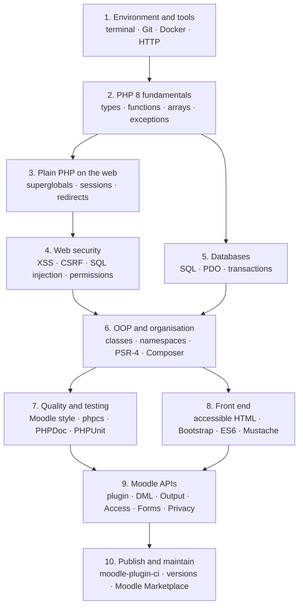

# PHP to Moodle Roadmap

[Português](README.md) · **English** · [Español](README.es.md)

A learning path from **plain PHP 8 (no framework)** to **Moodle plugin development**.

Existing PHP roadmaps lead to Laravel or Symfony. Moodle uses neither: it has its own architecture and APIs. This roadmap fills that gap. Every topic also shows **how it shows up in Moodle**, so you know why you are learning it.

**Interactive version (track your progress):** https://pherys.github.io/roadmap-php-moodle/?lang=en

**Also on roadmap.sh:** https://roadmap.sh/r/php-to-moodle

## Overview

Levels: **Essential** (learn before moving on) · **Important** (right after) · **Optional** (when you need it).

## Stages

1. **Environment and tools**: command line, Git and GitHub, an editor with PHP support, Docker basics, how the web works.
2. **PHP 8 fundamentals**: syntax, types, functions and scope (`global $DB`), arrays, multibyte strings, PHP 8 features, exceptions, `require_once`, JSON and dates.
3. **Plain PHP on the web**: superglobals and forms, sessions and cookies, headers and redirects, uploads, calling APIs.
4. **Web security**: input validation (`required_param`), XSS (`s()`, `format_string()`), CSRF (`sesskey`), SQL injection, authentication and authorisation, OWASP Top 10.
5. **Databases**: SQL, modelling, PDO, transactions, SQL that is portable across databases.
6. **OOP and organisation**: classes, inheritance and interfaces, traits, namespaces and autoloading (`classes/`), Composer, SOLID, design patterns.
7. **Quality and testing**: Moodle Coding Style, PHP_CodeSniffer + moodle-cs, PHPDoc, PHPUnit, Xdebug, PHPStan.
8. **Front end**: accessible HTML, Bootstrap/SCSS, JavaScript ES6 (AMD modules), Mustache templates, AJAX.
9. **The bridge: Moodle APIs**: plugin structure and types, Strings, Page/Output, DML, XMLDB, Access, Forms, settings, navigation, Events, Tasks, web services, Privacy, Hooks, File, Cache, Backup.
10. **Publish and maintain**: moodle-plugin-ci, Behat, supported versions, publishing on Moodle Marketplace, contributing to core.

The full content of each topic is in [`data.en.js`](data.en.js) and in the interactive version.

## Main references

- [PHP manual](https://www.php.net/manual/en/)
- [PHP: The Right Way](https://phptherightway.com/)
- [Moodle developer documentation](https://moodledev.io/)
- [Moodle Academy](https://moodle.academy/)

## Contributing

Fixes and suggestions are welcome, in any of the three languages. See [CONTRIBUTING.md](CONTRIBUTING.md).

## Licence

Content under [CC BY-SA 4.0](LICENSE): you may copy, adapt and redistribute it, as long as you give credit and keep the same licence.
