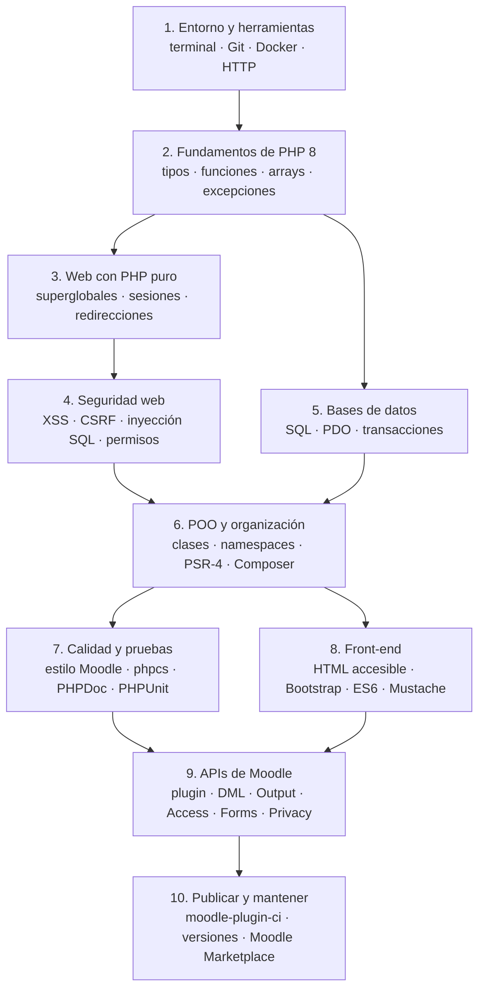

# Hoja de ruta de PHP a Moodle

[Português](README.md) · [English](README.en.md) · **Español**

Una ruta de aprendizaje desde **PHP 8 puro (sin framework)** hasta el **desarrollo de plugins de Moodle**.

Las hojas de ruta de PHP que existen llevan a Laravel o Symfony. Moodle no usa ninguno de los dos: tiene su propia arquitectura y sus propias APIs. Esta hoja de ruta cubre ese hueco. Cada tema muestra también **cómo aparece en Moodle**, para que sepas por qué lo estudias.

**Versión interactiva (marca tu progreso):** https://pherys.github.io/roadmap-php-moodle/?lang=es

## Vista general

Niveles: **Esencial** (estúdialo antes de seguir) · **Importante** (justo después) · **Opcional** (cuando lo necesites).

## Etapas

1. **Entorno y herramientas**: línea de comandos, Git y GitHub, editor con soporte para PHP, Docker básico, cómo funciona la web.
2. **Fundamentos de PHP 8**: sintaxis, tipos, funciones y ámbito (`global $DB`), arrays, cadenas multibyte, novedades de PHP 8, excepciones, `require_once`, JSON y fechas.
3. **Web con PHP puro**: superglobales y formularios, sesiones y cookies, cabeceras y redirecciones, subida de archivos, consumo de APIs.
4. **Seguridad web**: validación de entrada (`required_param`), XSS (`s()`, `format_string()`), CSRF (`sesskey`), inyección SQL, autenticación y autorización, OWASP Top 10.
5. **Bases de datos**: SQL, modelado, PDO, transacciones, SQL portable entre bases de datos.
6. **POO y organización**: clases, herencia e interfaces, traits, namespaces y autocarga (`classes/`), Composer, SOLID, patrones de diseño.
7. **Calidad y pruebas**: Moodle Coding Style, PHP_CodeSniffer + moodle-cs, PHPDoc, PHPUnit, Xdebug, PHPStan.
8. **Front-end**: HTML accesible, Bootstrap/SCSS, JavaScript ES6 (módulos AMD), plantillas Mustache, AJAX.
9. **El puente: APIs de Moodle**: estructura y tipos de plugin, Strings, Page/Output, DML, XMLDB, Access, Forms, ajustes, navegación, Events, Tasks, servicios web, Privacy, Hooks, File, Cache, Backup.
10. **Publicar y mantener**: moodle-plugin-ci, Behat, versiones soportadas, publicación en Moodle Marketplace, contribución al núcleo.

El contenido completo de cada tema está en [`data.es.js`](data.es.js) y en la versión interactiva.

## Referencias principales

- [Manual de PHP](https://www.php.net/manual/es/)
- [PHP: The Right Way](https://phptherightway.com/) (en inglés)
- [Documentación para desarrolladores de Moodle](https://moodledev.io/) (en inglés)
- [Moodle Academy](https://moodle.academy/)

## Contribuir

Las correcciones y sugerencias son bienvenidas, en cualquiera de los tres idiomas. Consulta [CONTRIBUTING.md](CONTRIBUTING.md).

## Licencia

Contenido bajo [CC BY-SA 4.0](LICENSE): puedes copiarlo, adaptarlo y redistribuirlo, siempre que des crédito y mantengas la misma licencia.
