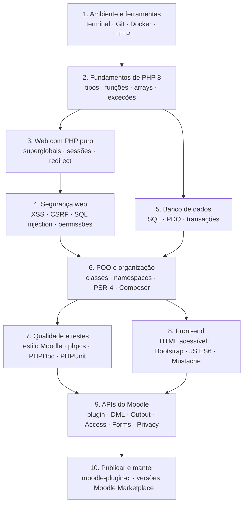

# Roadmap PHP para Moodle

**Português** · [English](README.en.md) · [Español](README.es.md)

Trilha de estudos do **PHP 8 puro (sem framework)** até o **desenvolvimento de plugins Moodle**.

Os roadmaps de PHP que já existem levam a Laravel ou Symfony. O Moodle não usa nenhum dos dois: tem arquitetura e APIs próprias. Este roadmap cobre essa lacuna. Cada tópico mostra também **como aquilo aparece no Moodle**, para você saber por que está estudando.

**Versão interativa (marque seu progresso):** https://pherys.github.io/roadmap-php-moodle/

## Visão geral

Prioridades: **Essencial** (estude antes de seguir) · **Importante** (logo depois) · **Opcional** (quando precisar).

## Etapas

1. **Ambiente e ferramentas**: linha de comando, Git e GitHub, editor com suporte a PHP, Docker básico, como a web funciona.
2. **Fundamentos de PHP 8**: sintaxe, tipos, funções e escopo (`global $DB`), arrays, strings multibyte, recursos do PHP 8, exceções, `require_once`, JSON e datas.
3. **Web com PHP puro**: superglobais e formulários, sessões e cookies, cabeçalhos e redirecionamento, upload, consumo de APIs.
4. **Segurança web**: validação de entrada (`required_param`), XSS (`s()`, `format_string()`), CSRF (`sesskey`), SQL injection, autenticação e autorização, OWASP Top 10.
5. **Banco de dados**: SQL, modelagem, PDO, transações, SQL portável entre bancos.
6. **POO e organização**: classes, herança e interfaces, traits, namespaces e autoload (`classes/`), Composer, SOLID, padrões de projeto.
7. **Qualidade e testes**: Moodle Coding Style, PHP_CodeSniffer + moodle-cs, PHPDoc, PHPUnit, Xdebug, PHPStan.
8. **Front-end**: HTML acessível, Bootstrap/SCSS, JavaScript ES6 (módulos AMD), templates Mustache, AJAX.
9. **A ponte: APIs do Moodle**: estrutura e tipos de plugin, Strings, Page/Output, DML, XMLDB, Access, Forms, configurações, navegação, Events, Tasks, web services, Privacy, Hooks, File, Cache, Backup.
10. **Publicar e manter**: moodle-plugin-ci, Behat, versões suportadas, publicação no Moodle Marketplace, contribuição com o core.

O conteúdo completo de cada tópico está em [`data.pt.js`](data.pt.js) e na versão interativa, que também está disponível em inglês e espanhol.

## Referências principais

- [Manual do PHP (pt-BR)](https://www.php.net/manual/pt_BR/)
- [PHP: The Right Way](https://phptherightway.com/) (em inglês)
- [Documentação para desenvolvedores Moodle](https://moodledev.io/)
- [Moodle Academy](https://moodle.academy/)
- [Moodle para Desenvolvedores, de Daniel Neis (pt-BR)](https://danielneis.github.io/moodleparadesenvolvedores/)

## Contribuir

Correções e sugestões são bem-vindas. Veja [CONTRIBUTING.md](CONTRIBUTING.md).

## Licença

Conteúdo sob [CC BY-SA 4.0](LICENSE): pode copiar, adaptar e redistribuir, desde que dê o crédito e mantenha a mesma licença.
